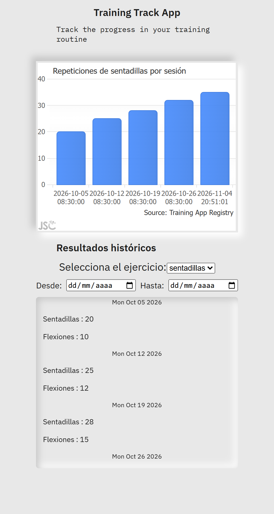
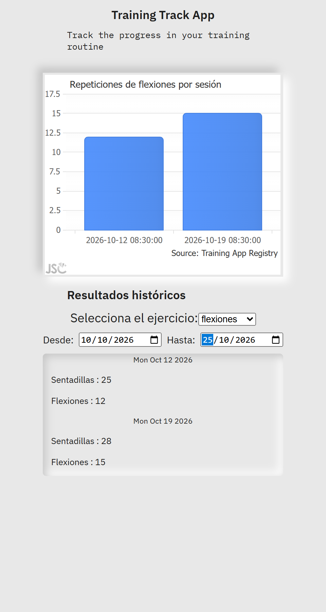

# TrainingTrack
MVP to Track physical activity. A list of exercises with reps.

[ link to project ](https://salacodigo.github.io/TrainingTrack/src/)

## Screenshots

| 1. User | 2. Routine | 3. Tracking |
|---|---|---|
|  |  |  |

| 4. Results | 5. Date range filter | 6. Filter by exercise |
|---|---|---|
|  |  |  |

The **Desde / Hasta** date range filters both the chart and the historic list. Both dates are optional and
inclusive: leave one empty to filter only from or until a date.

## Getting started

No build step is needed to run the app: it uses native ES modules and loads JSCharting from its CDN.

```bash
npm install          # only needed for tests tooling and Sass
npm start            # serves src/ at http://localhost:8080
npm test             # unit tests (Node built-in test runner, no extra dependencies)
npm run build:css    # compiles src/styles/scss into src/styles/css/index.css
```

Requires Node 20+ (for `node --test`) and Python 3 for `npm start` (any static server works).

## Architecture

```
src/js/
├── index.js            # Entry point: creates the views and connects them with callbacks
├── views/              # One module per screen; owns its DOM container and events
│   ├── userView.js
│   ├── exerciseView.js
│   ├── trackingView.js
│   └── resultsView.js
├── components/         # Reusable UI pieces; receive data/callbacks, never read global state
│   ├── DateRangeFilter.js
│   ├── SelectField.js
│   ├── NumberField.js
│   ├── ItemList.js
│   ├── SessionHistory.js
│   └── ExerciseChart.js
├── domain/             # Pure logic (no DOM, no libraries) — fully unit tested
│   ├── dateRange.js
│   └── exerciseSeries.js
├── state/
│   └── sessionStore.js # Current session + saved history (single source of truth)
├── services/
│   └── storage.js      # The only module that touches localStorage
└── utils/
    └── dom.js          # createElement, show/hide, clear helpers
```

Dependency direction: `views → components / state / domain`, `state → services`, `components → utils`.
Views never import each other, so a screen can be added, removed or reordered by changing only `index.js`.

Rules for new code:

- **New UI piece?** Add a component that takes its data and callbacks as arguments
  (see `createDateRangeFilter({ onChange })`) so it can be reused in any view.
- **New calculation?** Put it in `domain/` as a pure function and add a test in `test/`.
- **New persistence (e.g. a real database, item 8)?** Replace `services/storage.js`; nothing else changes.
- Text from the user is written with `textContent`, never `innerHTML`.

## Roadmap

```
1  [✓] - Make a function to create exercises
2  [✓] - Make a function to assign a number of reps to one of the exercises
     2.1 [✓] - Verify the existence of that exercise to update
3  [✓] - show the list of exercises with reps
4  [✓] - Use the same function of point 1, if the exercise exist,
    save the number of reps for each series
5  [✓] - add a complexity, using the date to save the data
6  [✓] - Make a filter to show results filtered by data
    6.1 [✓] - Make a filter with date's range
7  [✓] - Build the minimum acceptable HTML page
8  [ ] - Build a Database
9  [✓] - Exercises as a list
10 [✓] - Session Data presented in charts
11 [✓] - Historic Data presented in charts
12 [✓] - Present the chart based on the type of exercise. User can select the type of exercise
```
